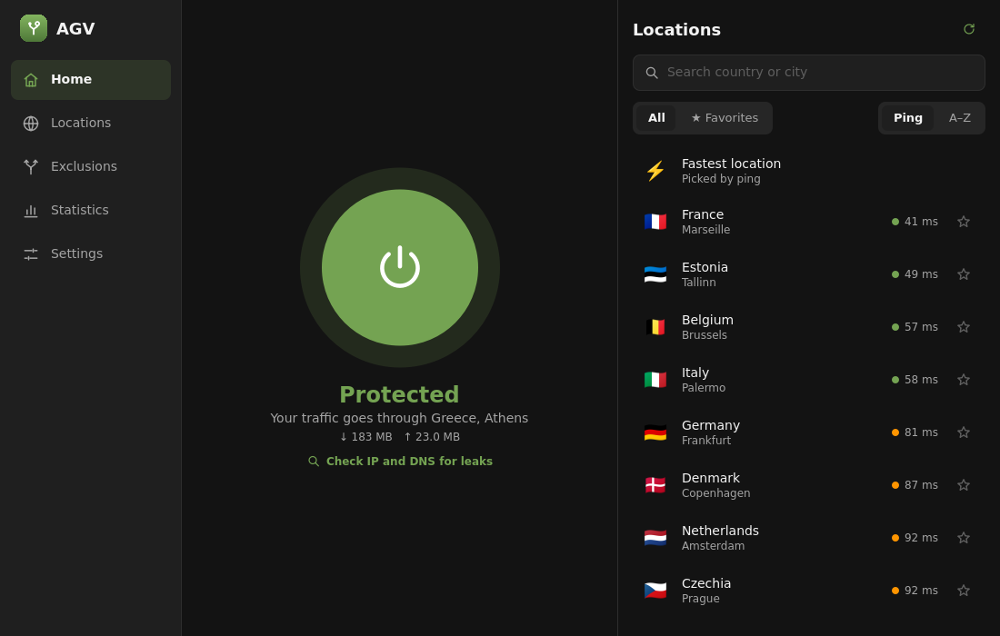
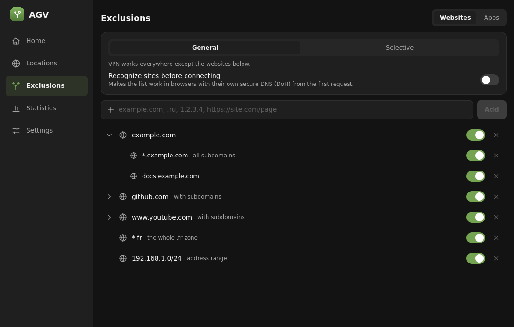
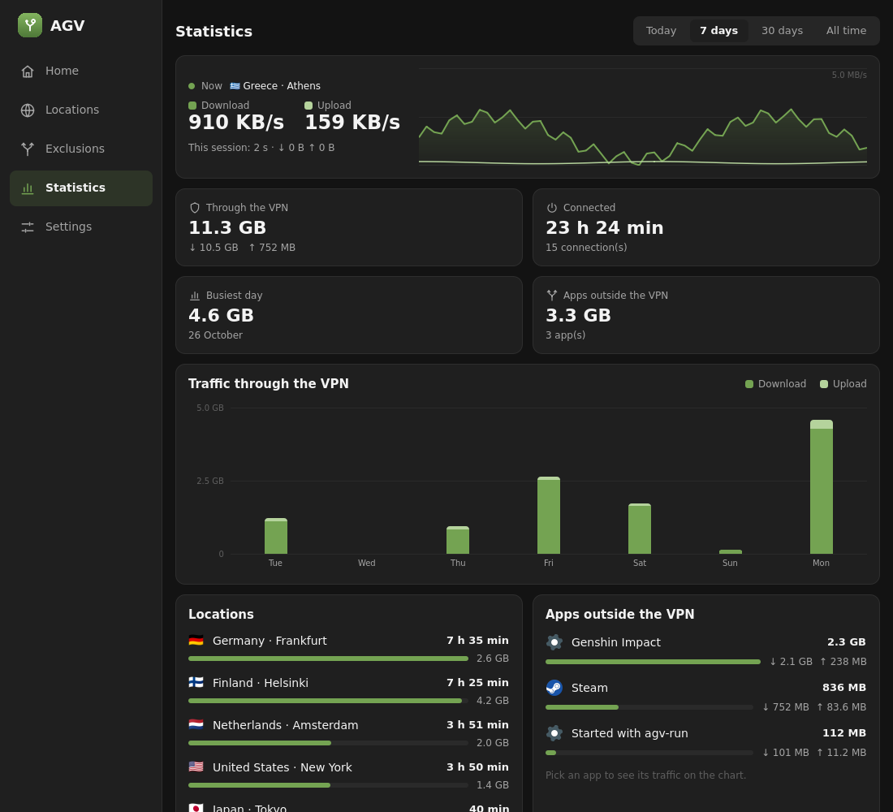

# AGV

An unofficial desktop client for [AdGuard VPN CLI](https://github.com/AdguardTeam/AdGuardVPNCLI)
on Linux, built with C++, Qt 6 and QML. Its main feature is the one the CLI lacks on Linux:
**excluding individual apps from the VPN**, the way the Windows client does.



- **Apps outside the VPN** (or only some apps through it): pick them from the menu, and they stay
  excluded however they are started; or run anything with `agv-run <command>`.
- **Websites**: each site with its subdomains, switch any of them off without deleting it, whole
  zones like `.fr`, addresses and ranges.
- **Kill switch** and **automatic reconnect** with notifications, **DNS kept inside the VPN** and a
  leak check.
- **Wi-Fi rules**: connect on networks you do not trust, disconnect on trusted ones.
- **Statistics**: live speed, traffic by day, locations, apps and sessions, CSV export.
- Locations with ping and favorites, TUN or SOCKS5 mode, HTTP/2 or QUIC, tray, autostart,
  English and Russian, light and dark, from a phone-sized window to a full screen.

| Exclusions | Statistics |
| --- | --- |
|  |  |

AGV is an independent project, not affiliated with or endorsed by AdGuard. It drives the official
`adguardvpn-cli`, which you install from AdGuard.

## Architecture

- `agvd` is a root daemon (systemd service). It runs `adguardvpn-cli`, owns routing, nftables and
  cgroups, and exposes the `org.agv.Daemon1` D-Bus API with polkit authorization.
- `agv-gui` is the unprivileged window and tray. It talks only to the daemon.
- `agv-run` starts a program already excluded from the VPN.
- `agvctl` controls the daemon from a terminal.

## Install

First install the AdGuard VPN CLI with AdGuard's script (AGV offers the command when it is missing):

```sh
curl -fsSL https://raw.githubusercontent.com/AdguardTeam/AdGuardVPNCLI/master/scripts/release/install.sh | sh -s -- -v
```

Then AGV:

- **Arch Linux**: the `.pkg.tar.zst` from [Releases](https://github.com/raitar239/agv-gui/releases)
  (`sudo pacman -U agv-gui-*.pkg.tar.zst`), or build it: `cd packaging/aur/agv-gui && makepkg -si`.
  AUR packages (`agv-gui`, `agv-gui-git`) are ready in `packaging/aur` and will be published once
  AUR registration reopens.
- **Debian, Ubuntu, Fedora**: the `.deb` and `.rpm` packages from
  [Releases](https://github.com/raitar239/agv-gui/releases).

```sh
sudo systemctl enable --now agvd
```

Then open "AGV" from the application menu and sign in.

## Build

Requirements: CMake ≥ 3.22, a C++20 compiler, Qt ≥ 6.4 (Core, DBus, Network, Gui, Widgets,
Quick, QuickControls2, Test). `-DAGV_BUILD_GUI=OFF` builds only the daemon, `agv-run` and `agvctl`.

```sh
cmake -S . -B build -G Ninja
cmake --build build
ctest --test-dir build
```

## Run the GUI

With agvd installed (see below), start `./build/src/gui/agv-gui`. It lives in the tray; closing
the window frees the interface. `--hidden` starts in the tray only. Against a development daemon
on the session bus: `AGV_SESSION_BUS=1 ./build/src/gui/agv-gui`.

## Try the daemon without installing

On the session bus `agvd` skips polkit. Point `--data-dir` at a HOME whose
`~/.local/share/adguardvpn-cli` is logged in:

```sh
./build/src/daemon/agvd --session --data-dir "$HOME" &
busctl --user call org.agv.Daemon1 /org/agv/Daemon org.agv.Daemon1 ListLocations
busctl --user get-property org.agv.Daemon1 /org/agv/Daemon org.agv.Daemon1 State
```

Connecting needs root, so `Connect` only works with the installed system service. To install a
development build (to `/usr/local` and `/etc`) and remove it again:

```sh
sudo scripts/dev-install.sh
sudo scripts/dev-install.sh --uninstall
```

## Terminal

```sh
agvctl                      # status
agvctl connect Frankfurt    # or: agvctl connect --fastest
agvctl disconnect
agvctl sites add example.com '*.example.com'
agvctl apps off Steam
agvctl stats week
```

`agvctl help` lists everything. It uses the same polkit rules as the window.

## Kill switch

With the kill switch on (Settings → Protection), agvd keeps traffic inside the VPN while it should
be up, including while it reconnects after a drop. Turning the VPN off in AGV lifts it, and so
does stopping agvd. If you are ever cut off and AGV does not respond:

```sh
sudo nft delete table inet agvd-killswitch
```

## Packages

`.github/workflows/ci.yml` builds and tests on Debian 12, Ubuntu 24.04, Fedora and Arch, and a
`v*` tag publishes the packages as a release. Locally, `sudo packaging/build-packages.sh` does the
same in Docker. AUR files are in `packaging/aur`; `packaging/aur/update.sh VERSION` prepares them
for a tag.

## License

[MIT](LICENSE). AGV is an independent project, not affiliated with or endorsed by AdGuard.
